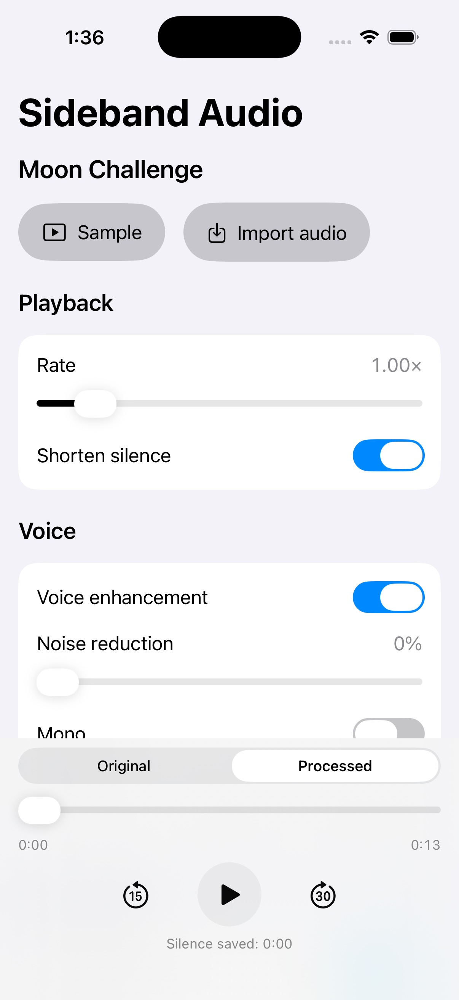
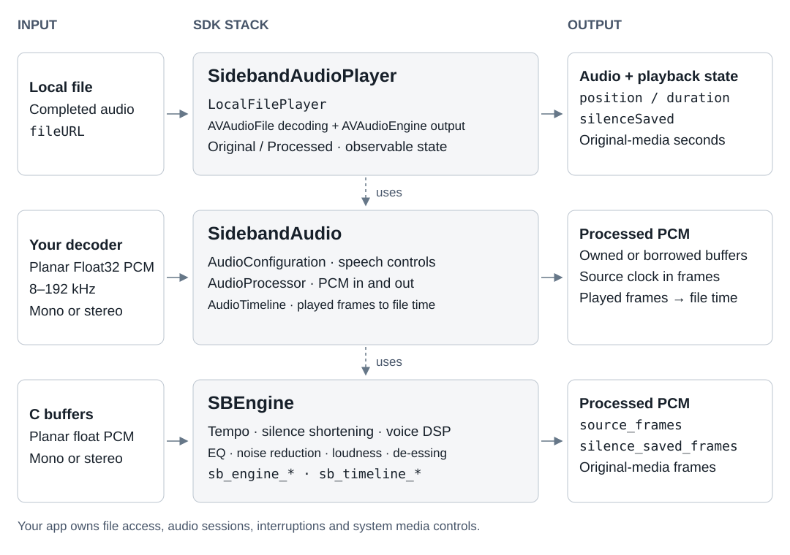

# Sideband Audio

Sideband Audio is a Swift package for spoken-word playback on iOS and macOS. Listeners finish sooner with pitch-preserving speed from 0.5x to 5x and shorter silences. Voice EQ and compression, noise reduction, de-essing and loudness normalization keep speech clear and even, and up to 12 custom EQ bands let listeners set their own tone. Your player shows correct file position after speed changes and removed pauses. Built in C on preallocated buffers and Accelerate, it spares your team the DSP work.



## APIs

Choose `SidebandAudioPlayer` to play local files, `SidebandAudio` to process PCM you decode yourself, or `SBEngine` to call the engine from C. The player uses the Swift processor, which wraps the C engine.

<picture>
  <source media="(prefers-color-scheme: dark)" srcset="Documentation/Images/APIStack-dark.svg">
  
</picture>

- `SidebandAudio` (Swift, Foundation)
  - Settings: `AudioConfiguration` holds the speech controls. `rate` is a 0.5...5 speed multiplier, `noiseReduction` is 0...1 and `normalizationTargetLUFS` is in LUFS. Up to 12 `EQBand` values set frequency in Hz, gain in dB and unitless Q. `EQBand.Kind` selects the filter shape and `DeEsser` selects sibilance reduction strength.
  - Processing: `AudioProcessor` takes planar Float32 mono or stereo PCM at 8...192 kHz and returns audio at the same sample rate and channel count. `ProcessedAudio` owns its buffers. `ProcessedAudioView` borrows buffers valid only until the callback returns. Each output frame has a `sourceFrames` position and cumulative `silenceSavedFrames` since reset, both in original-media frames. Silence savings exclude time saved by speed. A frame is one sample per channel.
  - Errors: `AudioProcessingError` identifies invalid formats, settings and input, stalled processing or failed allocations.
  - Clock: `AudioTimeline` maps the number of output frames actually played to file position and heard silence savings, both in source frames. Divide by the sample rate for seconds.
- `SidebandAudioPlayer` (Swift, AVFoundation, Observation)
  - Playback: `LocalFilePlayer` loads, plays, pauses and seeks local files. It is `@MainActor` and `@Observable`. `position` and `duration` use original-media seconds. `silenceSaved` counts heard savings in seconds. `measuredLoudness` is a LUFS estimate.
  - State: `PlaybackMode` selects processed audio or the original at 1x without DSP. `PlaybackState` reports playback status and `PlayerFailure` describes failures. Your app handles `AVAudioSession`, interruptions and system media controls.
- `SBEngine` (C11, libc and libm, Accelerate on Apple platforms)
  - Lifecycle: `sb_engine_create` allocates an engine. `sb_engine_push` returns the accepted input-frame count, so read output before retrying the remainder. `sb_engine_read` writes PCM and source-position and silence-savings metadata. After `sb_engine_finish`, keep reading until `sb_engine_is_drained` returns nonzero, then call `sb_engine_destroy`.
  - Settings: `sb_engine_configure` applies `SBEngineConfig`. `sb_engine_config_set_band` writes an `SBEngineEQBand`.
  - Measurements: `sb_engine_loudness` returns a LUFS estimate. `sb_engine_latency` returns DSP latency in source frames.
  - Source clock: `SBTimeline` and `sb_timeline_*` provide the C clock interface. `SBTimelineRun` stores compressed mappings from output frames to source position and removed silence.

## Use cases

Combine speed, silence shortening, speech processing and EQ in one `AudioConfiguration`.

### Listeners finish episodes sooner.

Combine faster playback with shorter pauses so listeners can finish long recordings in less time.

- Start with `.speech`, increase pitch-preserving `rate` and apply the configuration with `LocalFilePlayer.configure(_:)`. The preset combines silence shortening, voice enhancement and normalization. Show `silenceSaved` as a silence-savings readout.
- `setMode(.original)` plays the file at 1x without processing, so listeners can compare. `.processed` restores their settings.

### Speech stays clear and even from one episode to the next.

Balance speech levels and reduce distracting background noise or harshness across recordings.

- `voiceEnhancement` with `normalizationEnabled` and `normalizationTargetLUFS` brings shows to a similar level. Add `noiseReduction` for steady background noise, `deEsser` for sibilance and `mono` to center a recording heard on one side.
- Drive a loudness meter from `measuredLoudness` or `AudioProcessor.loudness`.

### Listeners set their own tone and save it.

Let listeners shape the sound and return to their preferred settings.

- Build an EQ editor from up to 12 `EQBand` values, with each shape chosen by `EQBand.Kind`. `equalizerGainDB(at:sampleRate:)` returns the custom EQ curve to draw.
- `AudioConfiguration` is `Codable`, so your app can store named presets itself. Check them with `validated()` before applying.

### Scrubbers, chapters and transcripts show the right time after speed changes and removed pauses.

Use original-recording time to connect your app’s scrubber, chapter navigation and transcript display.

- `LocalFilePlayer` `position`, `duration` and `seek(to:)` use original-media seconds, so they match your own chapter and transcript times.
- In your own pipeline, `AudioTimeline.original(at:)` maps played output frames to source frames. Divide by the sample rate for seconds. Call `played(_:)` as playback advances and query `silenceSaved(at:)` at the played frame count for silence savings the listener has heard.

### Your existing player or exporter gets the same speech processing.

Add speech processing to your playback or export pipeline while keeping your decoder and output.

- Pass decoded chunks to `AudioProcessor.process(_:)` and `finish()`, then send the output to your player or file writer. Your app keeps its decoder, output and encoder.
- `SBEngine` provides the same processing from C.

## Implementation guide

### Installation

Requires Swift 6.2. In Xcode, choose File > Add Package Dependencies, enter `https://github.com/0xSMW/SidebandAudio.git` and add `SidebandAudio`. Add `SidebandAudioPlayer` for file playback, or only `SBEngine` for the C API.

### Settings

`AudioConfiguration` is a `Codable`, `Equatable`, `Sendable` value that every product reads.

```swift
import SidebandAudio

var settings = AudioConfiguration.speech
settings.rate = 1.8
settings.noiseReduction = 0.3
settings.normalizationTargetLUFS = -16
settings.deEsser = .normal
settings.equalizer = [
    EQBand(kind: .highPass, frequency: 90, q: 0.707),
    EQBand(kind: .peak, frequency: 3_000, q: 1.2, gainDB: 2.5),
]

let accepted = try settings.validated()
let gainAt3k = try accepted.equalizerGainDB(at: 3_000, sampleRate: 44_100)
```

| Property | Values | `AudioConfiguration()` | `.speech` |
|---|---|---|---|
| `rate` | `0.5...5`, pitch preserved | `1` | `1` |
| `shortenSilence` | `Bool` | `false` | `true` |
| `voiceEnhancement` | `Bool`, voice EQ and compression | `false` | `true` |
| `mono` | `Bool`, averages both channels | `false` | `false` |
| `noiseReduction` | `0...1` | `0` | `0` |
| `normalizationEnabled` | `Bool` | `false` | `true` |
| `normalizationTargetLUFS` | `-20...-6` | `-14` | `-14` |
| `deEsser` | `.off`, `.normal`, `.strong` | `.off` | `.off` |
| `equalizer` | Up to 12 `EQBand` values with unique `id`s | `[]` | `[]` |

`EQBand(id:kind:frequency:q:gainDB:)` defaults to a `.peak` band at 1,000 Hz, Q 0.707 and 0 dB, and is `Identifiable` by its `UUID`. Ranges are `frequency` 20...20,000 Hz, `q` 0.3...8 and `gainDB` -12...12. `EQBand.Kind` is `.peak`, `.lowPass`, `.highPass`, `.bandPass`, `.notch`, `.lowShelf` or `.highShelf`.

`validated()` returns the configuration unchanged or throws `AudioProcessingError.invalidConfiguration(field)`, where `field` names the problem, such as `"rate"` or `"duplicate equalizer id"`. It rejects non-finite and out-of-range values and never clamps them.

`equalizerGainDB(at:sampleRate:)` returns the custom EQ response in dB for drawing a curve, excluding Voice Boost and dynamics. It validates the configuration and throws `.invalidFormat` unless the sample rate is 8...192 kHz and `0 < frequency < sampleRate / 2`. It can return `-infinity` at a notch center, so clip the chart yourself.

The limiter is always on, even in `AudioConfiguration()`, with a -0.7 dBFS sample-peak ceiling and no true-peak guarantee. Normalization uses a rolling K-weighted estimate, not a certified integrated-LUFS meter.

### Playing local files

`LocalFilePlayer` decodes a local file with `AVAudioFile`, processes it on a private serial queue and plays it through `AVAudioEngine`. It is `@MainActor` and `@Observable`. Audio stops when the player is deallocated.

```swift
import SwiftUI
import AVFoundation
import SidebandAudio
import SidebandAudioPlayer

struct PlayerView: View {
    let fileURL: URL
    @State private var player = LocalFilePlayer(configuration: .speech)
    @State private var message: String?

    var body: some View {
        VStack(spacing: 12) {
            Text(String(format: "%.1f / %.1f s, saved %.1f s", player.position, player.duration, player.silenceSaved))
            Button(player.isPlaying ? "Pause" : "Play") {
                if player.isPlaying { player.pause() } else { player.play() }
            }
            Button("1.5x") {
                var settings = player.configuration
                settings.rate = 1.5
                do { try player.configure(settings) } catch { message = error.localizedDescription }
            }
            if case .failed(let failure) = player.state { Text(failure.localizedDescription) }
            if let message { Text(message) }
        }
        .task {
            do {
                #if os(iOS)
                let session = AVAudioSession.sharedInstance()
                try session.setCategory(.playback, mode: .spokenAudio, policy: .longFormAudio)
                try session.setActive(true)
                #endif
                try await player.load(fileURL: fileURL)
            } catch {
                message = error.localizedDescription
            }
        }
    }
}
```

- `init(configuration: AudioConfiguration = .speech)` stores the settings without validating them. `load` reports invalid ones.
- `load(fileURL:) async throws` replaces the current source. It throws `PlayerFailure.invalidFileURL` for a non-file URL, `AudioProcessingError.invalidConfiguration` for invalid settings, `PlayerFailure.open` or `.processing` for audio it cannot decode or process, and `CancellationError` when a newer `load` or `stop()` supersedes it. Files must be 8...192 kHz with at least one frame. More than two channels are downmixed to stereo. Settings and mode changes made during a load apply before output starts.
- `configure(_:) throws` validates synchronously. On success `configuration` updates immediately. On failure it throws and keeps the old settings. A rate-only change keeps about 200 ms of already queued audio, so the new rate is heard after it. Any other change fades out briefly and regenerates from the audible position.
- `setMode(_:)` switches between `.processed` and `.original`. Original plays the decoded PCM at 1x without the engine. Settings stay editable and apply on return to Processed. The mode persists across loads.
- `seek(to:)` takes original-media seconds, clamped to `0...duration`. Seeking from `.ended` moves to `.paused`.
- `play()` starts or resumes, and restarts at 0 from `.ended`. `pause()` pauses.
- `stop()` cancels any load, unloads the source, releases output and returns to `.idle` with zeroed counters.
- `recoverAfterMediaServicesReset() async throws` reloads the current file and restores position, heard savings and play intent. It does nothing when no file is loaded.

`play()`, `pause()`, `seek(to:)`, `setMode(_:)` and `stop()` don't throw. A decode, DSP or output failure during playback sets `state` to `.failed(PlayerFailure)`. That state is final for the loaded file. `play()` and `pause()` are ignored until you call `load` again. The player rebuilds its graph on `AVAudioEngineConfigurationChange` and continues from the audible position.

Observable properties refresh about every 250 ms:

| Property | Meaning |
|---|---|
| `configuration` | Last accepted settings |
| `state` | `.idle`, `.loading`, `.ready`, `.playing`, `.paused`, `.ended` or `.failed(PlayerFailure)` |
| `isPlaying` | `state == .playing` |
| `mode` | Current `PlaybackMode` |
| `fileURL` | Loaded file, or `nil` |
| `position`, `duration` | Original-media seconds, independent of rate and removed silence |
| `silenceSaved` | Seconds of removed silence the listener has heard. Excludes time saved by `rate`. Carries across seeks and mode changes, resets on `load` and `stop` |
| `sampleRate` | File sample rate, or 0 before load |
| `measuredLoudness` | Loudness estimate in LUFS, or `nil` until valid |

`PlayerFailure` is `.invalidFileURL`, `.open(String)`, `.processing(AudioProcessingError)` or `.output(String)`. Both error enums conform to `LocalizedError`.

### Audio session and file access

The SDK never configures or activates `AVAudioSession`. On iOS, set a playback category and activate the session before `load`, as in the example. Your app also handles:

- Interruptions. Pause on `.began`. On `.ended` with `.shouldResume`, reactivate the session and call `play()` only if audio was playing before and the user hasn't paused since.
- Route changes. Pause on `.oldDeviceUnavailable`.
- Media services reset. Reactivate the session, then call `try await player.recoverAfterMediaServicesReset()`.

The player reads the file throughout playback. For a security-scoped URL, keep access open while it plays or copy the file into your container first. `Examples/SidebandAudioDemo/DemoModel.swift` copies imports and handles these session events. Now Playing and remote commands are up to the app.

### Processing PCM you decode

`AudioProcessor` takes planar Float32 PCM, mono or stereo, at 8...192 kHz. Read-only `sampleRate` and `channelCount` report the input format.

```swift
import SidebandAudio

let processor = try AudioProcessor(sampleRate: 44_100, channelCount: 2, configuration: .speech)

for chunk in decodedChunks {                // [[Float]], one array per channel
    let output = try processor.process(chunk)
    write(output.channels)
}
let tail = try processor.finish()           // audio still buffered at end of input
write(tail.channels)
```

The pointer form avoids copies and reuses storage allocated at construction:

```swift
try processor.process(left: leftPointer, right: rightPointer, frames: count) { view in
    copyToOutput(view.left, view.right, view.frameCount)
}
try processor.finish { view in
    copyToOutput(view.left, view.right, view.frameCount)
}
```

- `init(sampleRate:channelCount:configuration:) throws` throws `.invalidFormat`, `.invalidConfiguration` or `.allocationFailed`. The configuration defaults to `AudioConfiguration()`.
- `configure(_:) throws` validates and applies settings mid-stream. `configuration` holds the last accepted value.
- `process(_:)` needs exactly `channelCount` arrays of equal length. In `process(left:right:frames:consume:)`, `right` may be `nil` for mono. A non-finite sample rejects the whole call with `.invalidInput`. Otherwise every frame is accepted, and `consume` may run several times or not at all.
- `finish()` and `finish(consume:)` end input and drain the rest. Skip them and the last audio stays buffered. A repeat call after a full drain does nothing, and after a throwing callback it resumes the drain. `isFinished` turns true when the drain completes.
- `reset(at:seedLoudness:) throws` starts a new stream at an original-media frame, default 0, and keeps the settings. `seedLoudness` in LUFS starts normalization from a known level. A negative frame or non-finite seed throws `.invalidInput`. After finish starts, `process` and `configure` throw `.finished` until you reset. To seek, call `try processor.reset(at: frame, seedLoudness: processor.loudness)`.
- `loudness` is the LUFS estimate, or `nil` until valid. `latencyFrames` is DSP latency in source frames, and the stretcher buffers more on top. Latency delays output but does not shift timestamps.

`ProcessedAudio` owns `channels: [[Float]]`, `sourceFrames: [Double]` and `silenceSavedFrames: [Double]`, with a `frameCount` and public initializer. It is `Sendable`. `ProcessedAudioView` exposes `left`, `right`, `sourceFrames` and `silenceSavedFrames` as borrowed buffers, plus a `frameCount`. Copy any buffers you need after the callback returns. For mono input `right` aliases `left`.

`sourceFrames[i]` is the original-media frame of output frame `i`, accounting for tempo and removed silence. `silenceSavedFrames[i]` is the cumulative silence removed since the last reset, excluding tempo. Derive playback position from these values or `AudioTimeline`. Never multiply elapsed time by `rate`.

`AudioProcessor` is not `Sendable`. Use it from one serial owner, such as a decode queue, and schedule its output for playback. Reentrant calls throw `.invalidInput`. Don't call it from a real-time render callback. If `consume` throws, accepted input and delivered output stay consumed, so reset before retrying input. `.stalled` means the engine stopped making progress.

`AudioProcessingError` is `.invalidFormat`, `.invalidConfiguration(String)`, `.invalidInput`, `.finished`, `.stalled` or `.allocationFailed`.

### Mapping played output to file time

`AudioTimeline` stores the clock metadata from processor output and maps an output frame, counted from the last `reset(at:)`, to file position and heard savings.

```swift
let timeline = try AudioTimeline()
timeline.reset(at: startFrame)

try processor.process(left: leftPointer, right: rightPointer, frames: count) { view in
    try timeline.append(view)               // or append(_: ProcessedAudio)
    schedule(view)
}

// When your output reports frames played since the reset:
timeline.played(playedFrames)
let positionSeconds = timeline.original(at: playedFrames) / processor.sampleRate
let savedSeconds = timeline.silenceSaved(at: playedFrames) / processor.sampleRate
```

- `init() throws` throws `.allocationFailed`.
- `append(_:)` takes `ProcessedAudio` or `ProcessedAudioView`. It throws `.invalidInput` if channel lengths differ, values are non-finite, either value decreases, or the first source frame is below `baseOriginal`. It throws `.allocationFailed` without changing the clock.
- `played(_:)` records progress and returns it clamped to `0...outputEnd`, so queued silence never counts as saved before it plays. Call it as playback advances, because the timeline drops history more than 8,192 frames behind the last played frame.
- `original(at:)` returns the original-media frame. `silenceSaved(at:)` returns heard savings including `savedBefore`.
- `reset(at:)` moves savings heard up to `lastPlayed` into `savedBefore`, drops queued output and sets `baseOriginal`. Negative frames clamp to 0.
- `outputEnd` counts frames appended since the reset. `lastPlayed` is the clamped value returned by the last `played` call.

`AudioTimeline` is not `Sendable`. Use it from the processor's serial owner.

### C engine

`SBEngine` exposes the same engine through C. Each instance needs one serial owner. Creation allocates storage. Configuration and processing do not.

```c
#include <SBEngine.h>

enum { CAP = 4096 };
static float out_l[CAP], out_r[CAP];
static double src[CAP], saved[CAP];

static size_t drain(SBEngine *e) {
    size_t total = 0, n;
    while ((n = sb_engine_read(e, out_l, out_r, src, saved, CAP)) > 0) {
        consume(out_l, out_r, src, saved, n);
        total += n;
    }
    return total;
}

int process_file(void) {
    SBEngine *e = sb_engine_create(44100, 2, CAP);
    if (!e) return 0;

    SBEngineConfig c = sb_engine_default_config();
    c.rate = 1.5f;
    c.normalization_mode = 2;  /* custom target */
    c.target_lufs = -16;
    sb_engine_config_set_band(&c, 0, 5 /* low shelf */, 120, 0.7f, -3);
    if (!sb_engine_configure(e, &c)) { sb_engine_destroy(e); return 0; }
    sb_engine_reset(e, 0);

    const float *l, *r;
    size_t frames;
    while (decode(&l, &r, &frames)) {
        size_t done = 0;
        while (done < frames) {
            size_t accepted = sb_engine_push(e, l + done, r + done, frames - done);
            done += accepted;
            if (drain(e) == 0 && accepted == 0) { sb_engine_destroy(e); return 0; }  /* stalled */
        }
    }

    sb_engine_finish(e);
    while (!sb_engine_is_drained(e)) {
        if (drain(e) == 0 && !sb_engine_is_drained(e)) { sb_engine_destroy(e); return 0; }  /* stalled */
    }
    sb_engine_destroy(e);
    return 1;
}
```

| Function | Behavior |
|---|---|
| `sb_engine_create(sample_rate, channels, max_input_frames)` | 8...192 kHz, 1 or 2 channels, `max_input_frames` 1...1,048,576. That value sizes internal buffering and does not limit push length. Returns `NULL` for a bad format or failed allocation |
| `sb_engine_default_config()` | Rate 1, Smart Speed and Voice Boost on, `normalization_mode` 0 (follow Voice Boost), target -14 LUFS. This differs from Swift `AudioConfiguration()`, which maps to mode 1 (off) or 2 (custom target) |
| `sb_engine_config_set_band(config, index, type, frequency, q, gain_db)` | Writes band `index` below 12 and raises `eq_count` to include it. Types are 0 peak, 1 low-pass, 2 high-pass, 3 band-pass, 4 notch, 5 low shelf and 6 high shelf, matching `EQBand.Kind` raw values |
| `sb_engine_configure(engine, config)` | Returns 0 for `NULL`, a rate outside 0.5...5 or more than 12 bands. It checks nothing else, so apply the `validated()` ranges yourself |
| `sb_engine_reset(engine, original_frame)` | Starts a stream at an original-media frame. Keeps settings and clears saved-frame counters. Required before a new stream, a seek, or configuring after finish |
| `sb_engine_seed_loudness(engine, lufs)` | Optional. Call after reset or configure and before the first push. Invalid values are ignored |
| `sb_engine_push(engine, left, right, frames)` | Returns accepted frames and never discards the rest. On a partial or zero return, read output, then push the unaccepted suffix. `right` may be `NULL` for mono. Returns 0 after finish |
| `sb_engine_read(engine, left, right, source_frames, silence_saved_frames, capacity)` | Writes up to `capacity` frames of PCM and per-frame metadata with the same meaning as the Swift view. Every buffer except a mono `right` must be non-`NULL` |
| `sb_engine_finish`, `sb_engine_is_drained` | Finish ends input. Keep reading until `is_drained` returns nonzero |
| `sb_engine_loudness`, `sb_engine_latency` | LUFS estimate, -160 until valid. DSP latency in source frames |
| `sb_engine_custom_eq_gain_db(config, sample_rate, frequency)` | C form of `equalizerGainDB`. Returns `NAN` for invalid arguments. Needs no engine and allocates nothing |
| `sb_engine_destroy` | Frees the engine. Accepts `NULL` |

The timeline functions behind `AudioTimeline`:

| Group | Functions | Behavior |
|---|---|---|
| Instance | `sb_timeline_create`, `sb_timeline_clone`, `sb_timeline_destroy` | Create and clone return `NULL` on allocation failure. Clone copies retained runs |
| Updates | `sb_timeline_append`, `sb_timeline_reset`, `sb_timeline_played` | Append returns 0 on failure and leaves the clock unchanged. It does not check that values are finite or nondecreasing. `played` clamps only negatives, not to `output_end`. `reset` does not clamp negative frames |
| Queries | `sb_timeline_original_at`, `sb_timeline_saved_at`, `sb_timeline_output_end`, `sb_timeline_last_played`, `sb_timeline_base_original`, `sb_timeline_saved_before`, `sb_timeline_runs` | `runs` returns the retained `SBTimelineRun` array and writes its count. The pointer is valid until the next append, reset or destroy |
| Stateless runs | `sb_timeline_build_runs`, `sb_timeline_prune_count`, `sb_timeline_original`, `sb_timeline_saved` | Work on a caller-owned `SBTimelineRun` buffer and allocate nothing. The builder returns 0 unless `capacity >= frames` |

### Demo app and tests

Open `Examples/SidebandAudioDemo/SidebandAudioDemo.xcodeproj` and run the `SidebandAudioDemo` scheme on iOS 17 or later. Device builds need a signing team. `sh Scripts/build-demo.sh [destination]` builds an unsigned Release build, by default for `generic/platform=iOS Simulator`.

Adjust settings while playing the bundled sample or an imported file. Switch between Processed and Original to compare the result.

From the package root:

```sh
sh Tests/CEngine/run.sh                       # C engine tests under address and undefined-behavior sanitizers
SB_ENGINE_PORTABLE=1 sh Tests/CEngine/run.sh  # scalar implementation on Apple platforms
swift test --no-parallel                      # Swift processor and player tests
python3 Scripts/check-independence.py         # fails on app or network dependencies in Sources/ and Package.swift
```

### Engine implementation

The engine is an original C11 implementation. Apple builds use Accelerate for FFTs and correlation. A portable scalar implementation uses the C standard library and libm. The optional player uses AVFoundation for decoding and audio output.

### License

The code is available under the [MIT license](LICENSE). The [demo recording](Examples/SidebandAudioDemo/Resources/ATTRIBUTION.md) is public domain in the United States.
